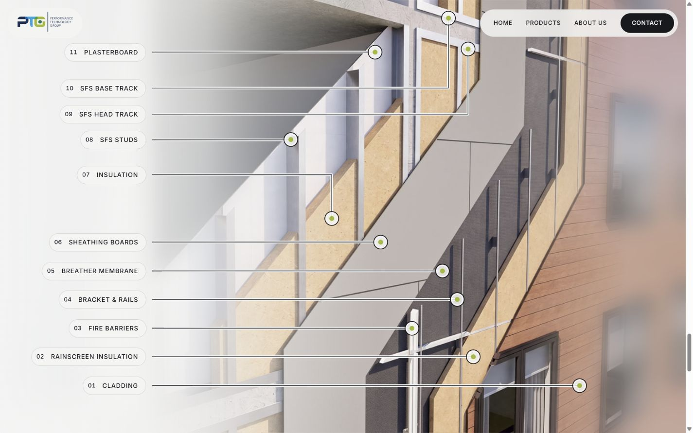
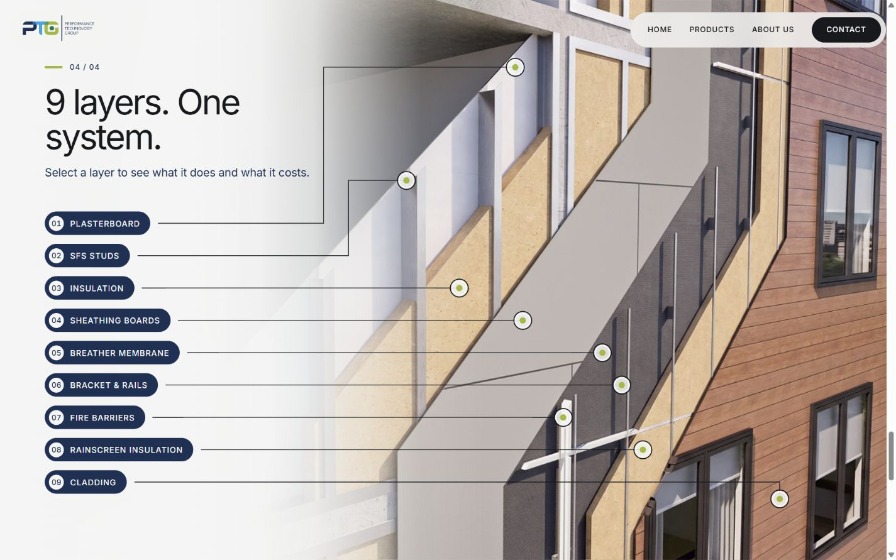
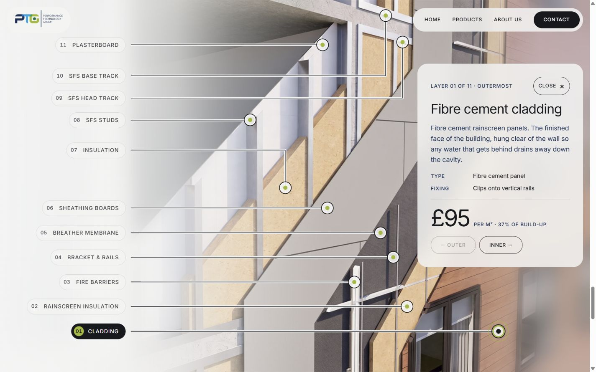
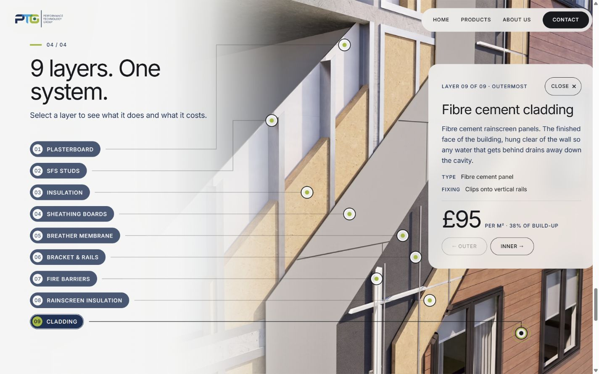
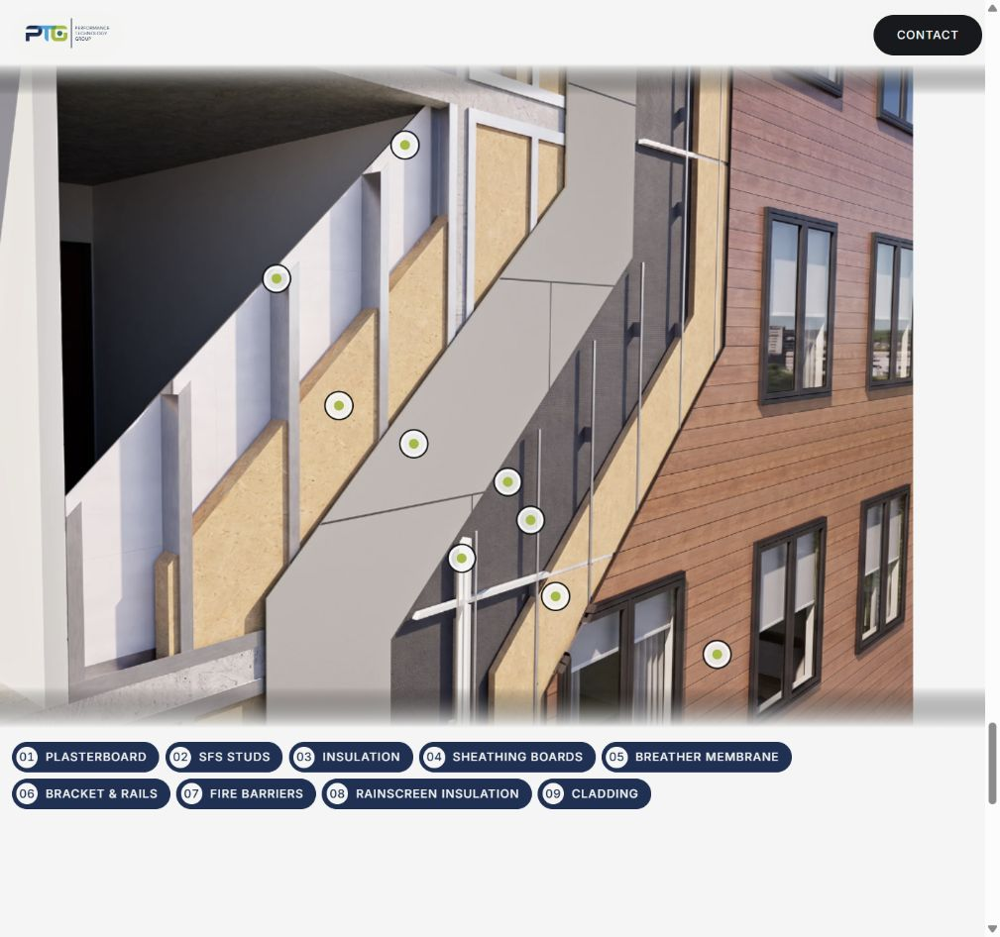
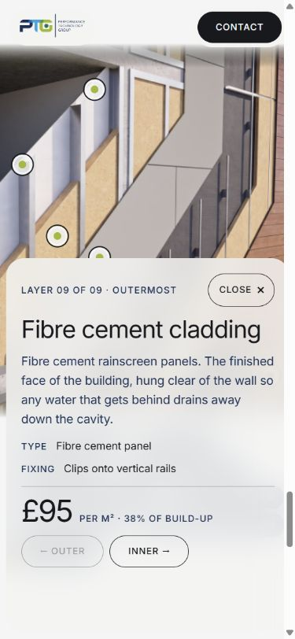

# Figma implementation review — 18 October 2026

Version 1.2.2 follows Sarvesh's latest **UI refinements · 18 Oct** edits, especially the Default Close component. The older Prototype annotation copies have different marker positions and are not the implementation reference for this round.

- [Edited desktop annotations and selected card](https://www.figma.com/design/JRckNrWn8mJHfyI6Ywihqz?node-id=43-200)
- [Landing and scroll-cue position](https://www.figma.com/design/JRckNrWn8mJHfyI6Ywihqz?node-id=43-2)
- [Canonical Default Close button](https://www.figma.com/design/JRckNrWn8mJHfyI6Ywihqz?node-id=41-79)

## Changes

The wall now has nine selectable layers, numbered 01 Plasterboard through 09 Cladding. Head/base track labels, markers and leaders are removed. Chips use PTG navy with paper text and a lime selected number. Reveal order remains outside to inside; Outer/Inner buttons and arrow keys follow the physical wall order.

Marker coordinates come from the edited review frame. Leaders use horizontal/vertical segments with square bends. At 1440 × 900, the top two risers match x520/x560 and the remaining lines meet the adjusted marker centres. Shorter desktop screens fit the label column beneath the chapter caption.

Every Close button uses the edited Default's separate 12 px label and 18 px ×, 6 px gap, and 88 × 44 target. Figma's Hover, Focus and Pressed variants have been reconciled to that content and geometry. The landing cue uses separate 12 px text and a 24 px arrow, at x1236/y406 on the desktop reference board. Narrow layouts keep it near the bottom to leave the hero readable.

The strong paper wash uses the Figma gradient stops. Browser backdrop blur approximates Figma's progressive 40-to-0 px blur with a mask, so a small rendering difference remains between Figma and the browser. Public desktop framing configuration centres the render like the Figma screen; engine source and timeline constants are unchanged.

## Validation

- Production build succeeds with all 198 non-empty WebP frames and all three existing logo/marker assets.
- JavaScript syntax and Git whitespace checks pass.
- Desktop checks: 1280 × 720, 1440 × 900, 1920 × 1080, 2560 × 1440. Nine labels fit; rendered leader geometry has zero diagonal segments and zero crossings.
- Near-square 1024 × 960: all nine labels fit in the Figma five-plus-four rows.
- Phone 390 × 844: nine controls fit; selected sheet matches the 495 px reference height, with its 88 × 44 Close target visible.
- All nine cards show the correct number/name. Outer/Inner and keyboard arrows step in the correct direction; physical boundaries disable the appropriate button.
- Close and Escape dismiss the card, return focus to the selected chip and preserve scroll position. Hidden annotations are removed from the keyboard route.
- Landing cue matches the measured desktop position and fades with the hero. Browser console reports no warnings or errors during the checked flows.
- Engine SHA-256 remains `259326a9b8c9422ae52082332df4d16a2cfc059fae2a45329b07f4c87292e6f3`. No engine, frame or logo/marker asset files changed.

## Screenshots

Before images show the previous local responsive finishing pass (v1.2.1), before this Figma reconciliation.

| View | Before | Updated |
|---|---|---|
| Landing |  |  |
| Explore |  |  |
| Selected layer |  |  |

## Publishing and remaining client content

Merge the pull request into `main` to trigger the existing Cloudflare Workers build. This branch has not been deployed directly.

Rates and destination links remain placeholders. The displayed cost percentage is calculated from the remaining nine entries (cladding is 38%, rather than the illustrative 42% in Figma). The production contact address, Products/About destinations and spec sheet still need client content.
